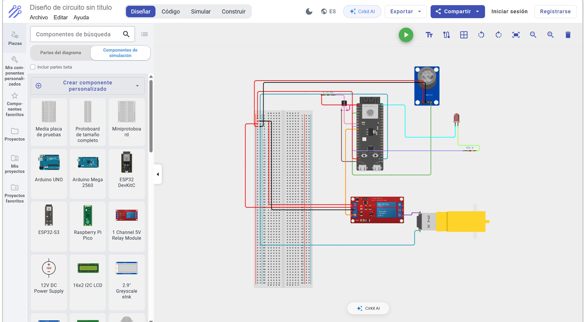
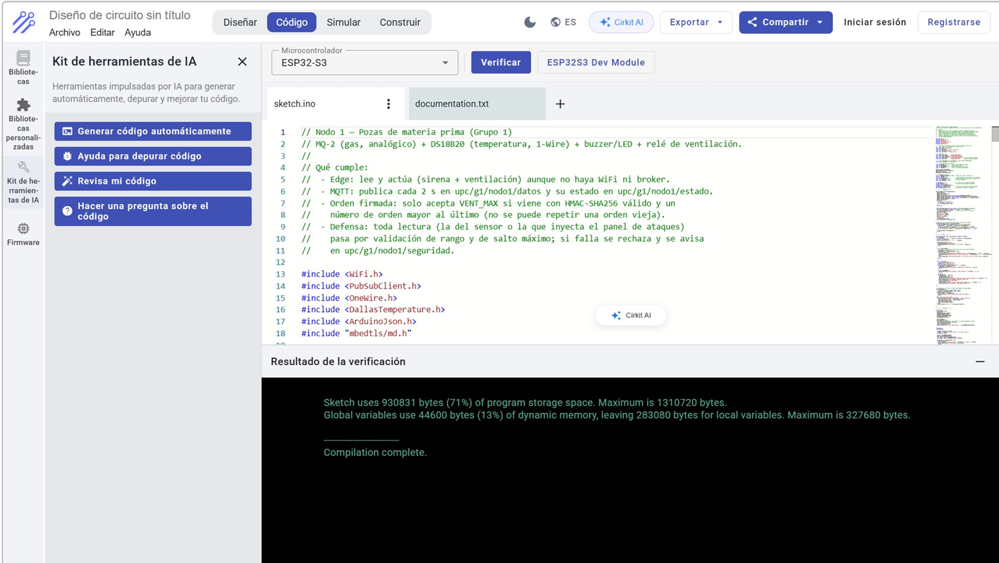
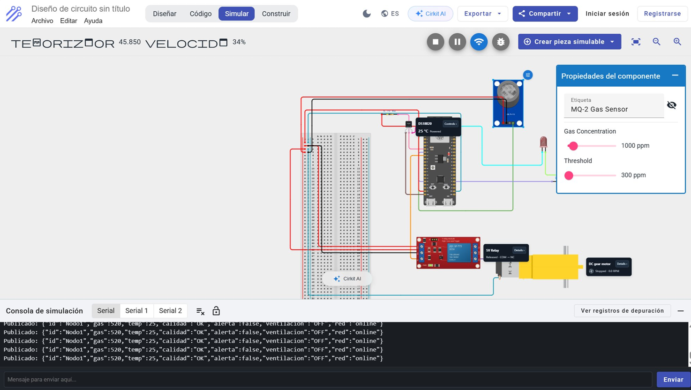
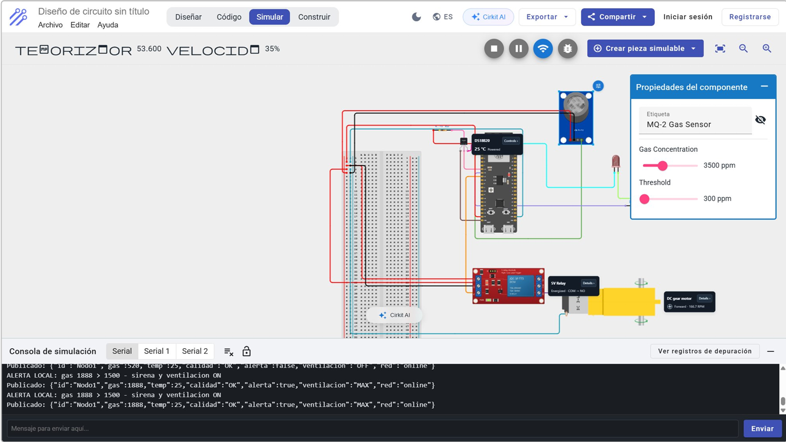
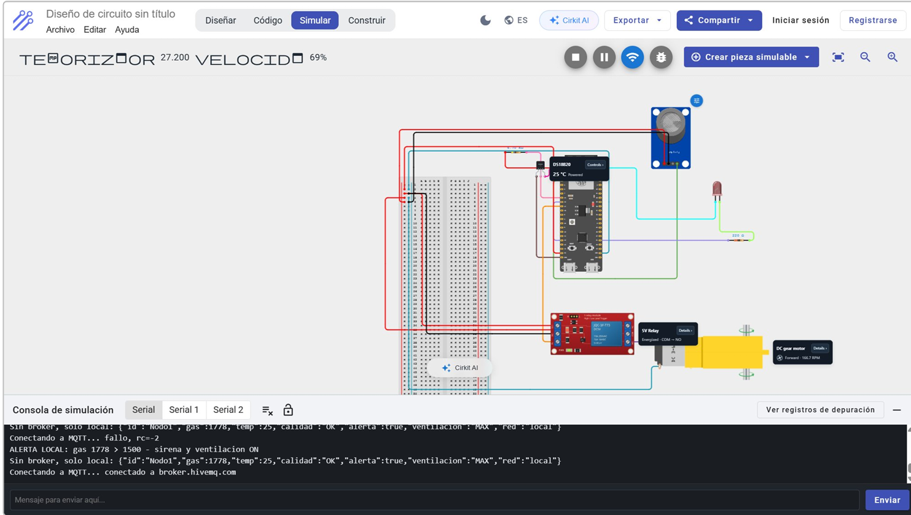
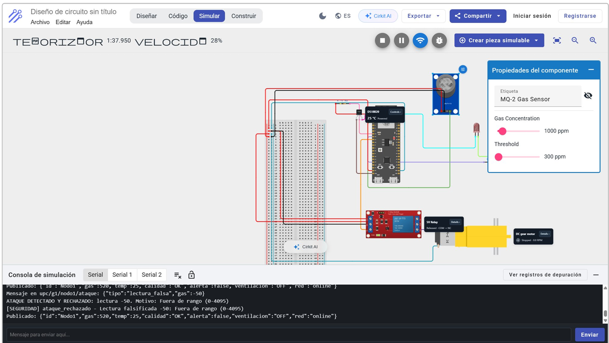
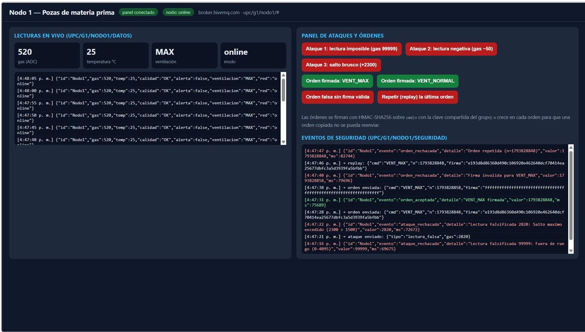
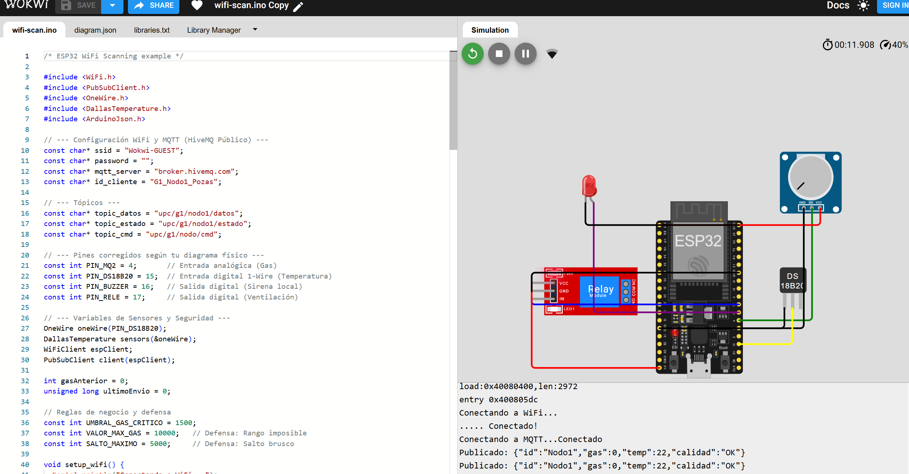
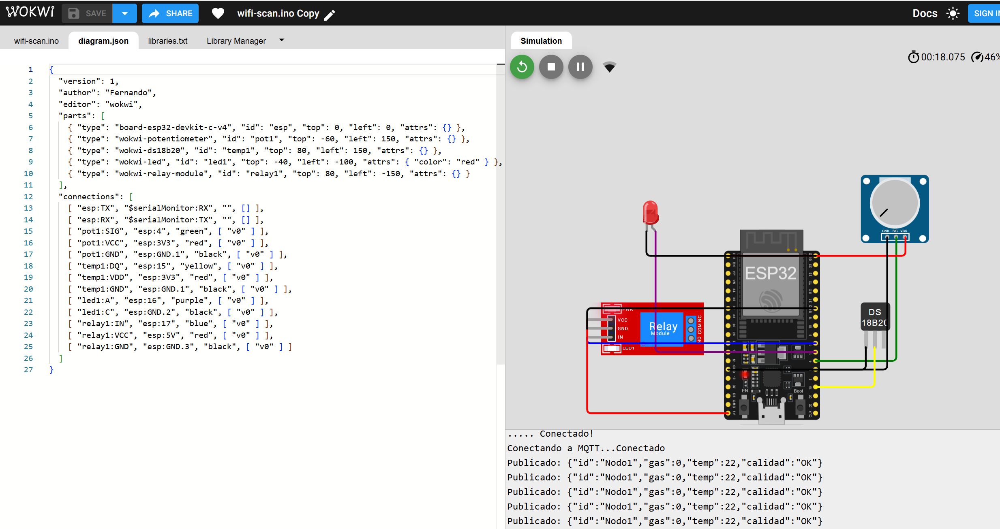
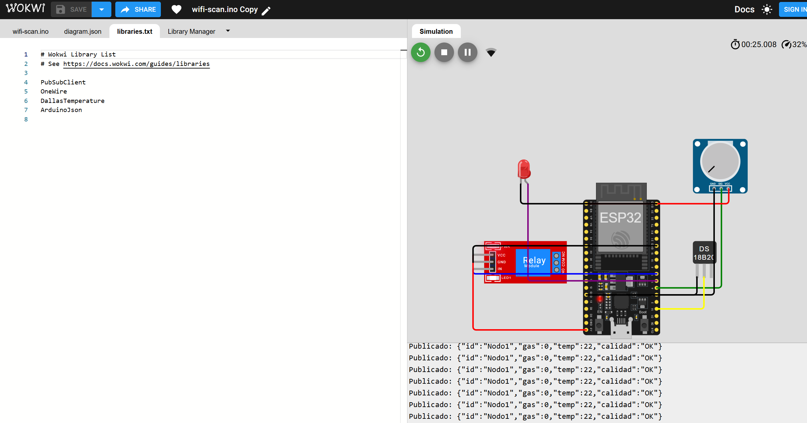

## Evidencia:

### Cirkuit
Evidencia de funcionamiento
#### 1.1 Cirkuit
;
#### 1.2 Compilación del firmware
;
#### 1.3 Lectura normal
;
#### 1.4 Alerta y actuación local
;
#### 1.5 Edge: actúa sin internet
;
#### 1.6 Ataque rechazado (lectura falsificada)
;
#### 1.7 Orden firmada de ventilación máxima
;
### MQTT y panel de ataques
;
### Wokwi
;
;
;
