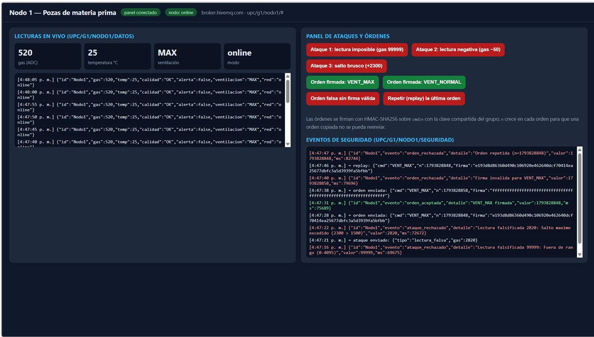
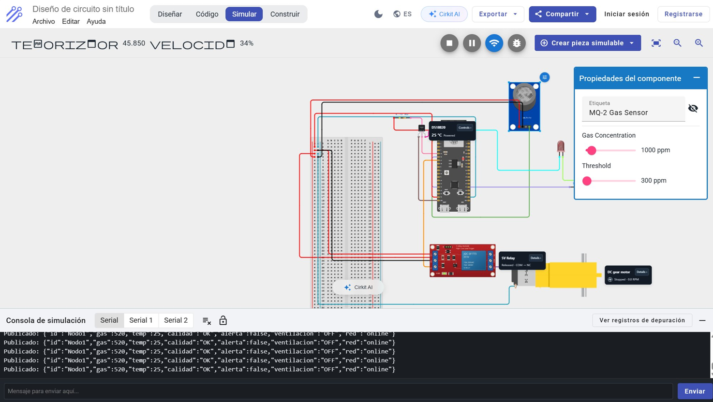
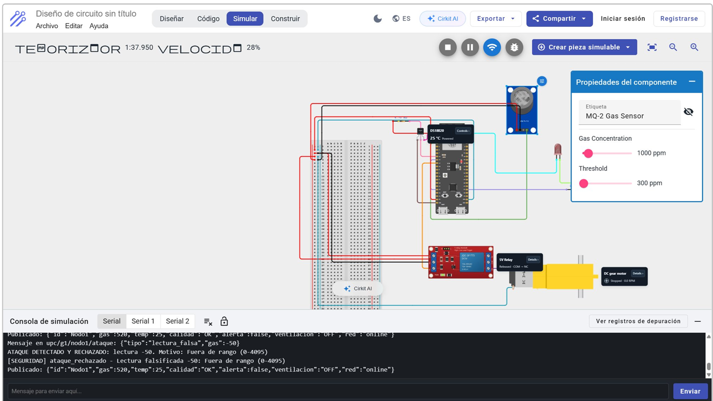

# Nodo 1 — Pozas de materia prima

**Responsable:** Fernando

## Componentes
MQ-2 (analógica), DS18B20 (1-Wire), buzzer y relé de ventilación.

## Reglas y tareas
Debe actuar en Edge sin internet y recibir orden firmada de ventilación máxima si falla el lavador.

## Ataque y defensa
Lectura falsificada imposible; validación de rango y salto máximo.

## Lo que debes subir aquí
- `sketch.ino` — firmware completo para ESP32.
- `diagram.json` — circuito exportado de Wokwi.
- `libraries.txt` — librerías usadas (si corresponde).
- Capturas o logs reales que demuestren detección, actuación y rechazo del ataque.
- Código de tu panel/botón de ataque integrado en la carpeta que acuerdes con Eduardo.

## Registro de entrega
- **Enlace Wokwi:** https://wokwi.com/projects/479819491217347585 
- **Enlace Cirkit (sección de nodo):** https://app.cirkitdesigner.com/project/75988b2c-c401-4ed8-ae5e-e7d56159e44f
- **Publicación MQTT:** 
;
- **Actuación comprobada:**
;
- **Ataque rechazado y registrado:** 
;

No agregar firmware simulado o capturas ficticias para llenar estos campos.
